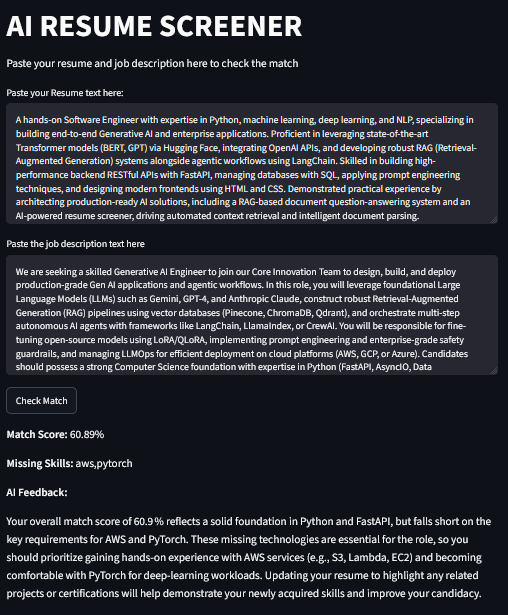

# AI Resume Screener

**Live Demo:** https://sathvika-resume-screener.streamlit.app

An AI-powered tool that compares a resume with a job description, gives a match score, finds missing skills and generates short feedback.



## Features
- Match score (%) using semantic similarity
- Detects missing skills required by the job description
- AI-generated feedback on how to improve the resume
- Saves every check in a SQLite database

## Tech Stack
- Python
- FastAPI (backend)
- Streamlit (frontend)
- Groq API (openai/gpt-oss-20b)
- HuggingFace Embeddings (all-MiniLM-L6-v2)
- scikit-learn (cosine similarity)
- SQLite

## How It Works
1. User pastes resume text and job description in the Streamlit UI.
2. Streamlit sends both to the FastAPI `/checkmatch` endpoint.
3. Both texts are converted into embeddings.
4. Cosine similarity gives the match percentage.
5. Skills in the job description are compared with the resume to find missing skills.
6. Groq LLM generates short, actionable feedback.
7. The result is saved in SQLite and shown in the UI.

## Setup

1. Clone the repository
```
git clone https://github.com/sathvika-v-dev/ai-resume-screener.git
cd ai-resume-screener
```

2. Create and activate a virtual environment
```
python -m venv venv
venv\Scripts\activate
```

3. Install dependencies
```
pip install -r requirements.txt
```

4. Create a `.env` file with your Groq API key
```
GROQ_API_KEY=your_key_here
```

5. Create the database
```
python setup_db.py
```

6. Start the backend
```
uvicorn api:app --reload
```

7. In a second terminal, start the frontend
```
streamlit run app_ui.py
```

## Future Improvements
- Upload resume as PDF instead of pasting text
- Smarter skill extraction (word-boundary matching / NLP-based)
- Larger skills list
- Show check history in the UI